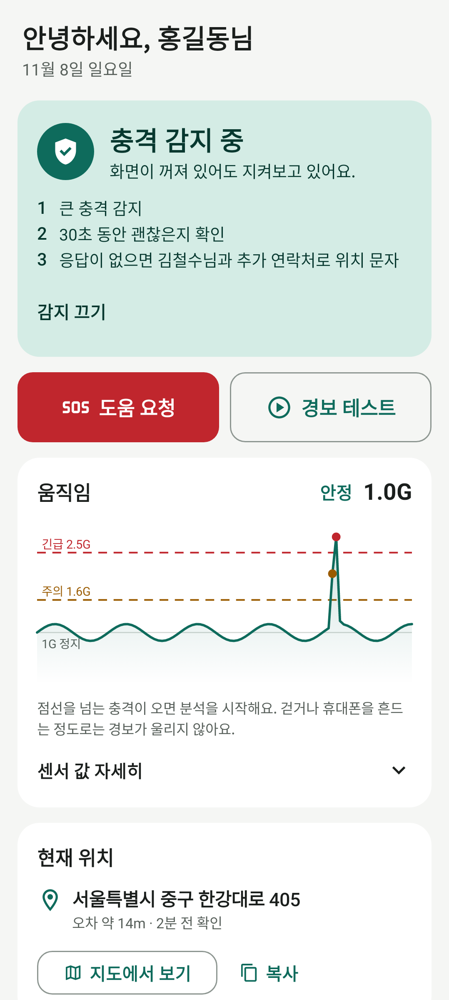
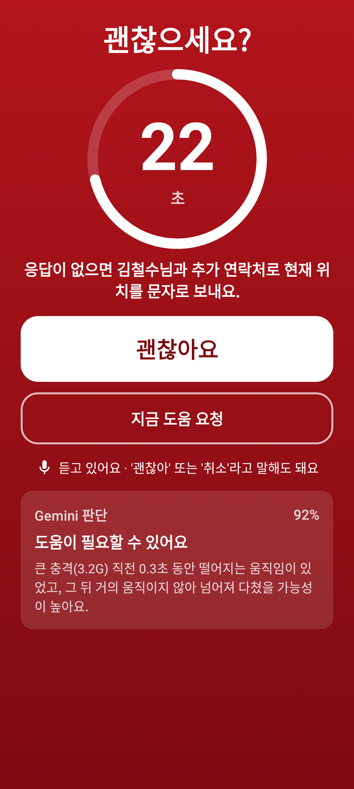
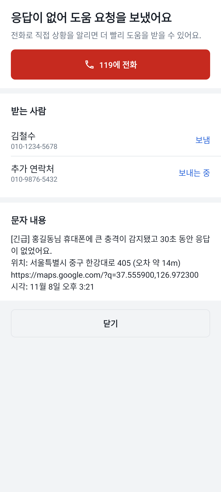
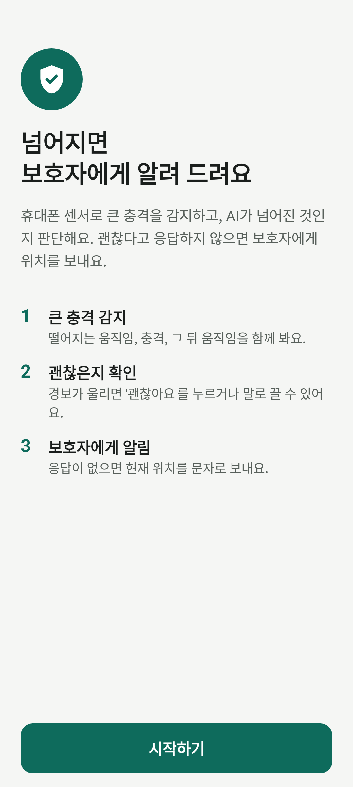
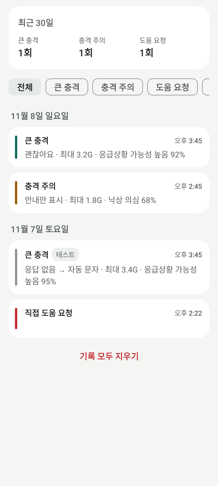
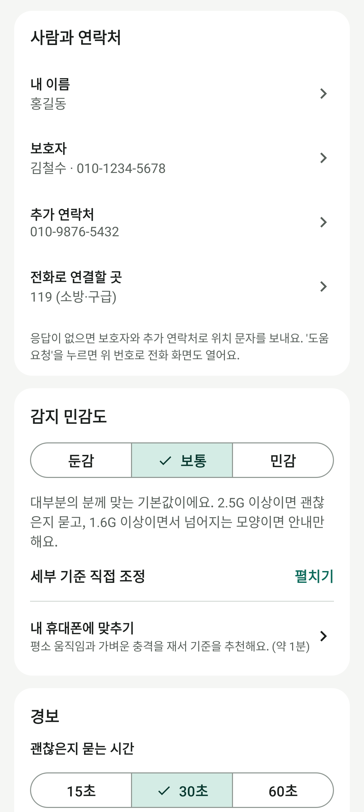

# AI 충격 감지 경보 앱

휴대폰을 지니고 있다가 넘어지거나 큰 충격을 받으면, 먼저 괜찮은지 묻고 응답이 없을 때 보호자에게 현재 위치를 문자로 보내는 안드로이드 앱입니다.

**설치하기: https://eunyool10.github.io/KTAIContest-Submission/**

| 홈 | 경보 | 도움 요청 결과 |
|:---:|:---:|:---:|
|  |  |  |
| **처음 설정** | **기록** | **설정** |
|  |  |  |

## 이렇게 동작해요

1. **감지**: 가속도·자이로 센서를 1초에 50번 읽어요. 충격이 기준을 넘으면 직전 1초의 떨어지는 움직임(자유낙하), 충격 크기, 2초 뒤의 자세 변화와 움직임을 함께 분석해요.
2. **판단**: Gemini API가 센서 수치를 보고 넘어진 상황인지 판단해요. API 키는 앱의 설정 → 판단 방식에서 넣을 수 있어요. 키가 없거나 9초 안에 답이 없으면 기기 안 규칙으로 바로 판단해요. '정상'이면 경보 없이 안내만 해요.
3. **확인**: "괜찮으세요?" 화면과 경보음·진동·음성 안내로 15/30/60초 동안 물어요. 화면 버튼, 알림 버튼, 또는 "괜찮아"라는 말로 끌 수 있어요. 화면이 꺼져 있거나 잠겨 있어도 화면이 켜지면서 떠요.
4. **도움 요청**: 응답이 없으면 보호자와 추가 연락처에 주소와 지도 링크가 담긴 문자를 자동으로 보내요. '도움 요청'을 직접 누르면 119·112·보호자 중 정해 둔 곳의 전화 화면도 열어요.

그 밖에 이런 기능이 있어요.

- 화면이 꺼져 있어도 계속 감지하고, 재부팅하거나 앱을 업데이트한 뒤에도 감지가 다시 켜져요.
- 홈 화면에서 준비 상태(권한, 연락처, 배터리 최적화 등)를 점검하고 바로 고칠 수 있어요.
- 감지 민감도(둔감/보통/민감)를 고르거나 직접 조정할 수 있고, 내 휴대폰에 맞춰 보정할 수도 있어요.
- 경보 테스트로 전체 과정을 미리 해 볼 수 있어요. 테스트에서는 문자를 보내지 않아요.
- 충격 기록을 날짜별로 보여 주고, 어두운 테마도 지원해요.

## 권한

| 권한 | 쓰는 곳 |
|---|---|
| 위치 | 도움 요청 문자에 현재 위치를 넣어요. |
| 문자 | 응답이 없을 때 보호자에게 자동으로 문자를 보내요. |
| 알림 | 감지 상태와 경보를 알림으로 보여 줘요. |
| 마이크 | 경보 중 "괜찮아"라고 말해서 끌 수 있어요. 녹음은 저장하지 않아요. |
| 전체 화면 알림, 배터리 최적화 제외 | 잠금 화면 위로 경보를 띄우고, 절전 중에도 감지를 이어 가요. |

## 테스트

```bash
./gradlew testDebugUnitTest      # 감지 로직(넘어짐·걷기·떨어뜨린 뒤 다시 집기), 음성 명령, 보정 계산
./gradlew recordRoborazziDebug   # 화면 스크린샷을 app/src/test/screenshots 에 다시 만들어요.
```

## 구조

```
app/src/main/java/com/example/
├─ detect/   충격 분석(FallDetector), 판단(Gemini·기기 안 규칙), 테스트용 낙상 데이터
├─ engine/   감지 → 판단 → 확인 → 도움 요청 흐름(GuardEngine), 위치, 경보음, 문자, 센서
├─ service/  화면이 꺼져도 감지하는 서비스, 알림, 재부팅·알림 버튼 처리
├─ data/     설정, 기록 DB
└─ ui/       화면
```

## 알아 두세요

- 휴대폰만 떨어뜨려도 넘어진 것처럼 보일 수 있어요. 그래서 문자를 보내기 전에 항상 먼저 물어봐요.
- 119·112에 자동으로 문자나 전화를 하지 않아요. 자동 문자는 보호자와 추가 연락처에만 가요.
- 감지 중에는 센서를 계속 읽어서 배터리를 조금 더 써요.
- 이 앱은 응급 구조 서비스를 대신하지 않아요.
